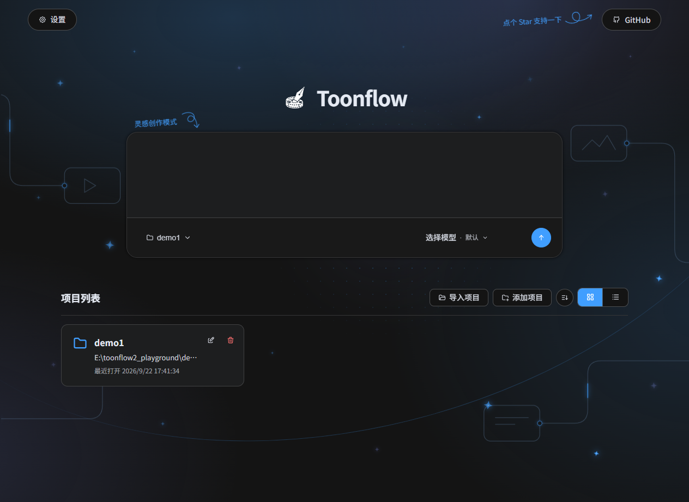
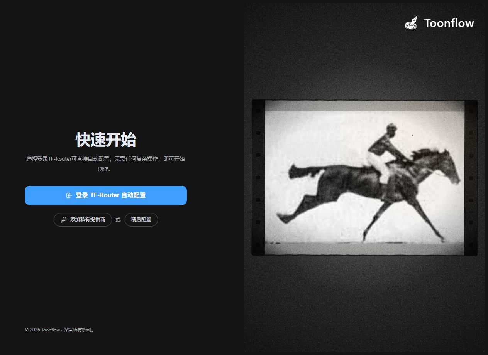
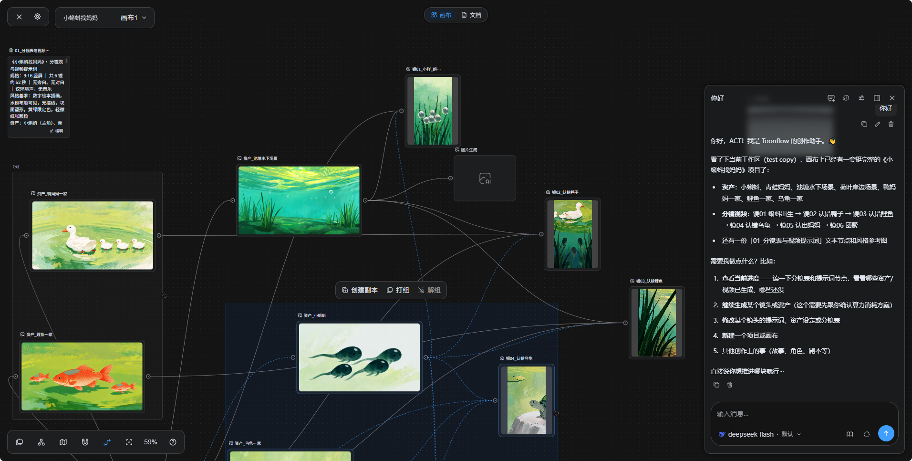
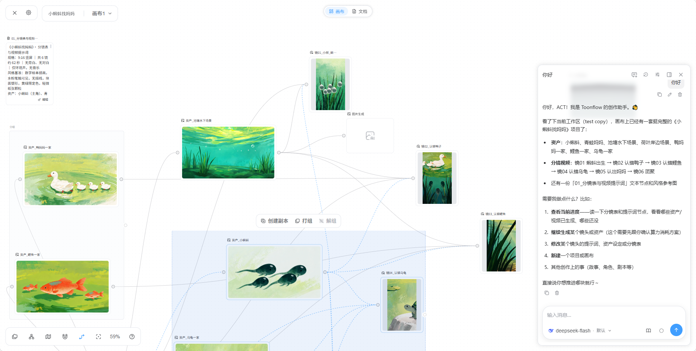
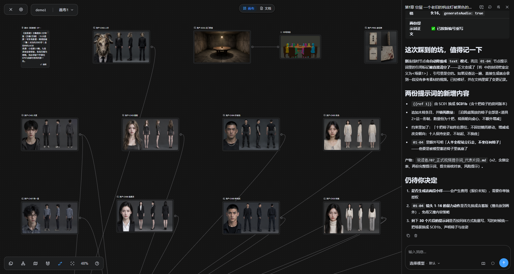
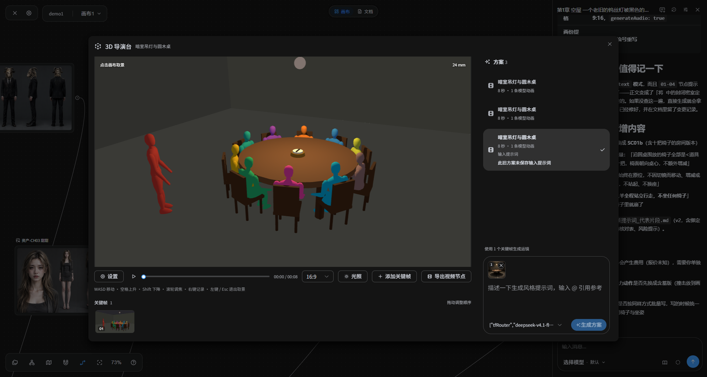
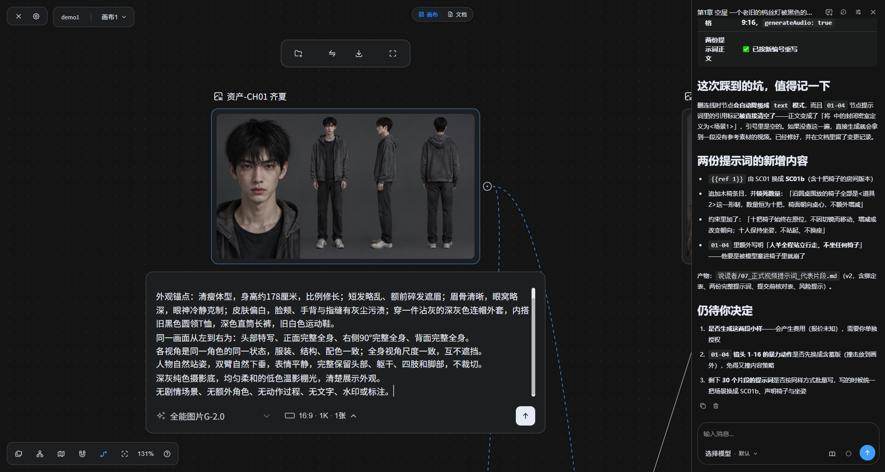
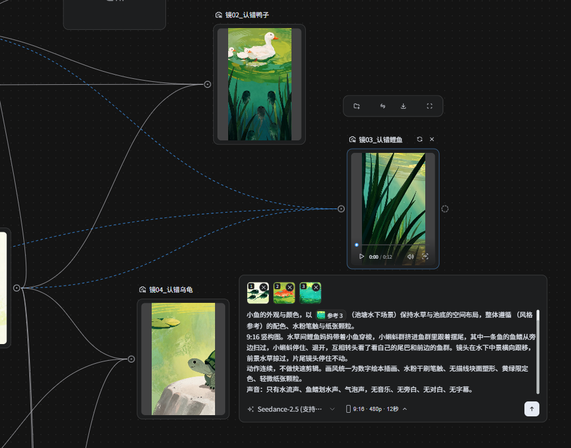
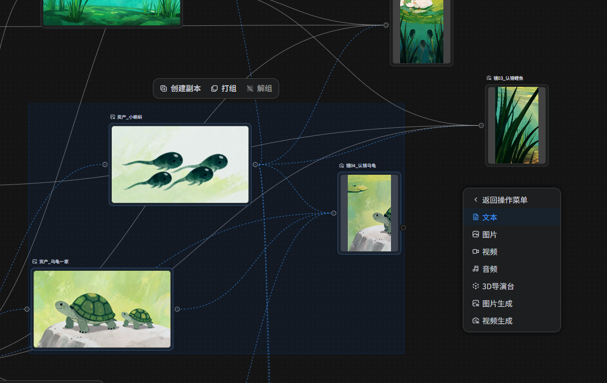
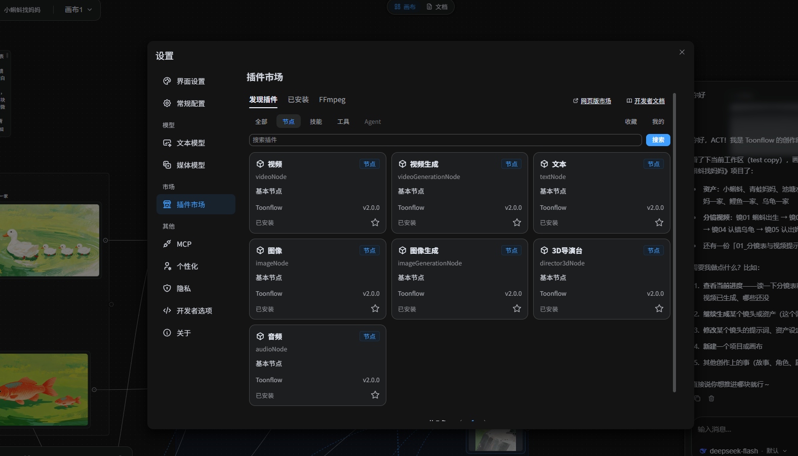

<p align="center">
  
</p>

<h1 align="center">Yoyo短剧平台</h1>

<p align="center">面向短剧、漫剧与短视频创作的开源 AI 创作平台</p>

<p align="center">
  <a href="https://github.com/ImYoyoData/Yoyo-sketch/releases">下载</a> ·
  <a href="./docs/development.md">开发文档</a> ·
  <a href="./LICENSE">MIT 许可证</a>
</p>

<p align="center">
  &nbsp;
  &nbsp;
  &nbsp;
  
</p>

支持 21 种界面语言：简体中文、繁體中文、English、日本語、Русский、Tiếng Việt、ไทย、한국어、हिन्दी、Bahasa Indonesia、Bahasa Melayu、Filipino、বাংলা、اردو、தமிழ்、తెలుగు、मराठी、ਪੰਜਾਬੀ、العربية、فارسی、Türkçe。

Yoyo短剧平台是面向短剧、漫剧和短视频创作者的开源 AI 创作工具。通过无限画布编写剧本与分镜、管理角色和场景素材、生成图片与视频。支持本地部署、自由接入模型，并可通过 AI Agent、MCP 与插件扩展创作流程。

---

## 1. 🌟 亮点

Yoyo短剧平台把剧本、资产与视频片段整合进同一张无限画布。

| 能力 | 说明 |
| --- | --- |
| 🏠 **本地部署** | 项目与素材保存在自己的设备或服务器，支持桌面、Android、Docker 与服务器部署，无需登录注册。 |
| 🖼️ **无限画布** | 在同一画布中组织剧本、角色、场景与视频片段。 |
| 🔌 **MCP** | 通过 MCP 连接外部工具与服务。 |
| 🧩 **插件扩展** | 通过自建插件节点、工具、文件扩展与技能扩展创作能力。 |
| 🤖 **开放 Agent** | 开放提示词、工具和 A2A，支持自定义 Agent 行为及外部协作。 |
| 🔧 **自由接入模型** | 配置第三方 API，也可接入本地 ComfyUI 和 LLM。 |
| 🌐 **多语言支持** | 支持 21 种界面语言。 |

### 如何用 Yoyo短剧平台制作 AI 短剧与漫剧

1. **编写剧本与分镜**：在文本节点中整理故事、人物设定和镜头描述，使用语言模型辅助创作，再审阅与修改内容。
2. **准备角色与场景素材**：导入参考图片，或通过图片生成节点制作角色、场景和分镜图。
3. **生成视频镜头**：连接文本与图片参考，选择视频模型和生成模式，按镜头生成视频片段。
4. **预览、整理与下载**：在无限画布中预览和组织图片、视频片段，下载素材后按创作需求继续处理。

支持的参考素材、视频时长、分辨率和音频能力取决于所选模型与供应商。

### 常见问题

**Yoyo短剧平台可以用于哪些 AI 短剧和漫剧制作环节？**

Yoyo短剧平台提供文本、图片与视频生成节点，可用于剧本与分镜创作、角色和场景素材制作、视频镜头生成，以及素材的预览与整理。创作者需要审阅和调整内容，具体生成能力取决于配置的模型。

**Yoyo短剧平台免费吗？模型调用需要付费吗？**

Yoyo短剧平台采用 MIT 开源许可，可自行部署。第三方模型服务的 API 调用可能收费；使用本地模型或 ComfyUI 时，需要自行准备相应的运行环境与算力。

**可以接入自己的模型和 ComfyUI 工作流吗？**

可以配置语言模型与媒体模型服务，也可通过自定义供应商适配接入已有的 ComfyUI 工作流。具体接入方式取决于服务 API、模型与工作流。

---

## 2. 📸 截图

<div align="center">

<a href="./docs/images/screenshots/projectHome.png"></a><br /><sub>项目首页与灵感创作</sub>

<a href="./docs/images/screenshots/quickStart.png"></a><br /><sub>首次启动与快速配置</sub>

<a href="./docs/images/screenshots/canvasDark.png"></a><br /><sub>创作画布 · 深色主题</sub>

<a href="./docs/images/screenshots/canvasLight.png"></a><br /><sub>创作画布 · 浅色主题</sub>

<a href="./docs/images/screenshots/assetCanvas.png"></a><br /><sub>角色、场景与道具资产</sub>

<a href="./docs/images/screenshots/directorStudio.png"></a><br /><sub>3D 导演台与镜头预演</sub>

<a href="./docs/images/screenshots/characterImageGeneration.png"></a><br /><sub>角色三视图与图片生成</sub>

<a href="./docs/images/screenshots/videoGeneration.png"></a><br /><sub>多参考素材视频生成</sub>

<a href="./docs/images/screenshots/nodeMenu.png"></a><br /><sub>节点菜单与分组操作</sub>

<a href="./docs/images/screenshots/pluginMarket.png"></a><br /><sub>插件管理</sub>

</div>

---

## 3. 🚀 下载并安装

### 3.1 客户端安装

| 操作系统 | 安装包 |
| -------- | ------ |
| Windows x64 | [EXE 安装包](https://github.com/ImYoyoData/Yoyo-sketch/releases) |
| Windows ARM64 | [EXE 安装包](https://github.com/ImYoyoData/Yoyo-sketch/releases) |
| macOS Apple Silicon（ARM64，macOS 14 及以上） | [DMG 安装包](https://github.com/ImYoyoData/Yoyo-sketch/releases) |
| macOS Intel（x64，macOS 14 及以上） | [DMG 安装包](https://github.com/ImYoyoData/Yoyo-sketch/releases) |
| Linux x64（Debian / Ubuntu） | [DEB 安装包](https://github.com/ImYoyoData/Yoyo-sketch/releases) |
| Linux ARM64（Debian / Ubuntu） | [DEB 安装包](https://github.com/ImYoyoData/Yoyo-sketch/releases) |
| Android ARM64 | [APK 下载](https://github.com/ImYoyoData/Yoyo-sketch/releases/latest) |

Android 版仅支持 ARM64 设备，下载发布页中的 `yoyo-版本号-android-arm64.apk` 安装。手机内置本地 Bun 后端，可独立运行；也可从首页「设备互联」扫码或手动连接已开启共享的电脑或远程后端（支持局域网与公网）。

Windows 安装器会自动检测并安装 WebView2；如果安装后打开闪退，请前往 [WebView2 下载页面](https://developer.microsoft.com/microsoft-edge/webview2/) 手动安装运行时。

Windows 的 Intel / AMD 电脑选择 `yoyo-版本号-Setup.exe`，ARM64 电脑选择 `yoyo-版本号-win-arm64-Setup.exe`。ARM64 需要 .NET Framework 4.8.1，较新的 Windows 11 已内置。

Linux 选择对应架构的 `yoyo-版本号-linux-x64.deb` 或 `yoyo-版本号-linux-arm64.deb`，在下载目录执行 `sudo apt install ./安装包文件名.deb`，安装后从应用菜单打开。安装需要联网；apt 会准备 FFmpeg、curl、unzip、CA 证书等依赖，安装脚本在解包应用前下载固定版本的 Bun 并校验大小与 SHA-256，配置阶段再安装运行时。下载或校验失败会在解包前中止安装。

macOS 两种架构均使用统一的 Electrobun SDK，最低支持 macOS 14。选择对应架构的 `yoyo-版本号-macos-arm64.dmg` 或 `yoyo-版本号-macos-x64.dmg`，打开后将 `yoyo.app` 拖入“应用程序”，再从“应用程序”打开。未签名的构建首次打开需在“系统设置 → 隐私与安全性”中允许，或用右键菜单选择“打开”。旧版 Intel Mac 客户端首次迁移时须下载完整 DMG 覆盖安装，不能通过增量更新直接迁移；安装前退出应用并备份原数据目录。

<details>
<summary><strong>macOS 无法安装或打开时的处理方法</strong></summary>

**1. 在“隐私与安全性”中允许 Yoyo短剧平台**

如果提示“无法验证开发者”或“Apple 无法检查 App 是否包含恶意软件”，先尝试打开 Yoyo短剧平台，再前往“系统设置 → 隐私与安全性”，找到被阻止的提示，点击“仍要打开”，并按提示确认。详见 [Apple 官方说明](https://support.apple.com/zh-cn/102445)。

**2. 仍因系统隔离限制无法打开时，再尝试移除隔离属性**

确认应用来自发布页，并已放入“应用程序”后，在终端执行以下命令，再重新打开。应用名称或安装位置不同时，请调整路径。

```bash
sudo xattr -rd com.apple.quarantine /Applications/yoyo.app
```

**3. 最后手段：临时允许任何来源的 App**

前两种方法均无效且确认应用来源可信时，可尝试在终端执行：

```bash
sudo spctl --master-disable
```

随后打开“系统设置 → 隐私与安全性”，在“安全性”中的“允许从以下位置下载的 App”选择“任何来源”（如果系统提供该选项），并按提示确认。不同 macOS 版本的选项与命令支持可能不同。

此操作会放宽所有 App 的安全限制。完成后建议将允许来源恢复为“App Store 和被认可的开发者”。

</details>

---

### 3.2 Docker 安装

先安装 Git、[Docker Engine](https://docs.docker.com/engine/install/) 和 Docker Compose；Windows / macOS 可使用 Docker Desktop 的 Linux 容器模式。仓库提供 [Dockerfile](./Dockerfile)、[Compose 配置](./compose.yaml) 和 [构建排除规则](./.dockerignore)，基于 Bun 1.4.3 构建，镜像内包含 FFmpeg。

<details>
<summary><strong>展开 Docker 安装步骤</strong></summary>

克隆源码后，在仓库根目录执行：

```sh
git clone https://github.com/ImYoyoData/Yoyo-sketch.git
cd Yoyo-sketch
docker compose up -d --build
```

首次构建会安装依赖并编译内置节点、工具、Web 与 Server。启动后访问 `http://127.0.0.1:3000`；远程主机可按下方“访问与数据说明”通过 SSH 隧道访问。首次启动会初始化内置插件，并提供 `myProject` 工作目录。

配置、插件和项目文件保存在 Docker 命名卷 `yoyoData` 中，挂载至容器的 `/app/data/`。卷的实际名称带有 Compose 项目前缀；停止或重建容器会保留数据，**请勿使用 `docker compose down -v`，该命令会删除数据卷**。

```sh
docker compose logs -f yoyo  # 查看日志
docker compose stop             # 停止服务
docker compose start            # 再次启动
docker compose down             # 删除容器，保留数据卷
```

需要增加项目目录时，可在页面的“选择服务器工作目录”弹窗中点击“新建文件夹”。弹窗也支持文件和文件夹的重命名、删除。也可在服务运行期间通过命令行创建：

```sh
docker compose exec yoyo mkdir -p /app/data/workspaces/newProject
```

备份时先停止服务，复制完成后再启动：

```sh
docker compose stop
docker compose cp yoyo:/app/data ./yoyoBackup
docker compose start
```

</details>

---

### 3.3 服务器安装

适用于直接在 Linux 服务器上运行 Web 与 Server。以下以 Ubuntu / Debian 为例，使用项目指定的 [Bun 1.4.3](https://bun.sh/docs/installation)。

<details>
<summary><strong>展开服务器安装步骤</strong></summary>

安装运行环境：

```sh
sudo apt-get update
sudo apt-get install -y git curl unzip ffmpeg
curl -fsSL https://bun.com/install | bash -s "bun-v1.4.3"
export PATH="$HOME/.bun/bin:$PATH"
bun --version
```

克隆源码并启动：

```sh
git clone https://github.com/ImYoyoData/Yoyo-sketch.git
cd Yoyo-sketch
bun install --frozen-lockfile

# 构建内置节点、工具、Web 与 Server
bun run build:server
mkdir -p data/workspaces/myProject
bun run start:server
```

看到“服务启动成功”后，可在服务器本机访问 `http://127.0.0.1:3000`。上述命令以前台方式运行，按 `Ctrl+C` 停止；需要开机自启和进程托管时，可参考 [Bun 的 systemd 部署指南](https://bun.sh/guides/ecosystem/systemd)，将工作目录设为仓库目录，启动命令设为 Bun 的绝对路径加 `run start:server`，使用有权读写该目录的用户运行。

</details>

---

### 3.4 访问与数据说明

- 当前服务使用固定端口 `3000`，业务页面与 API 没有独立登录鉴权。服务器安装时，请通过防火墙或安全组限制 `3000` 端口的访问来源；公网访问需配置带认证的反向代理。
- 个人远程使用可在自己的电脑上执行 `ssh -N -L 3000:127.0.0.1:3000 用户名@服务器地址`，保持连接后打开 `http://127.0.0.1:3000`，无需将服务器的 `3000` 端口向公网开放。
- 直接安装时，配置、插件与工作区默认保存在仓库的 `data/`；Docker 安装则保存在数据卷内的 `/app/data/`。迁移或备份时请完整保留。进入页面后选择服务器工作区内的 `myProject`，更多项目可在对应的 `workspaces/` 下创建子目录。
- 两种安装方式均包含系统 FFmpeg。模型服务的 API Key 仍需在页面内配置。

---

## 4. 🎬 作品示例

https://github.com/user-attachments/assets/2d9fddac-dfdf-4640-b030-b09d7f7287e9

### 案例信息

| 项目           | 记录                                                |
| -------------- | --------------------------------------------------- |
| 制作周期与成片 | 约 2 小时，成片约 2 分钟。                          |
| 视频模型       | Seedance 2.0                                        |
| 图片模型       | GPT Image 2                                         |
| 语言模型       | Claude Opus 4.6                                     |
| 模型调用费用   | 约 ¥130，其中语言约 ¥10、视频约 ¥120、图片不足 ¥1。 |

费用为该案例的记录，仅供参考，实际成本取决于模型服务、生成次数与参数。演示视频为压缩后的 480p 版本。

---

## 5. 📜 开源许可

本项目采用 [MIT 许可证](./LICENSE)。第三方依赖和素材遵循各自的许可与版权声明，原始版权声明见 [LICENSE](./LICENSE)。
